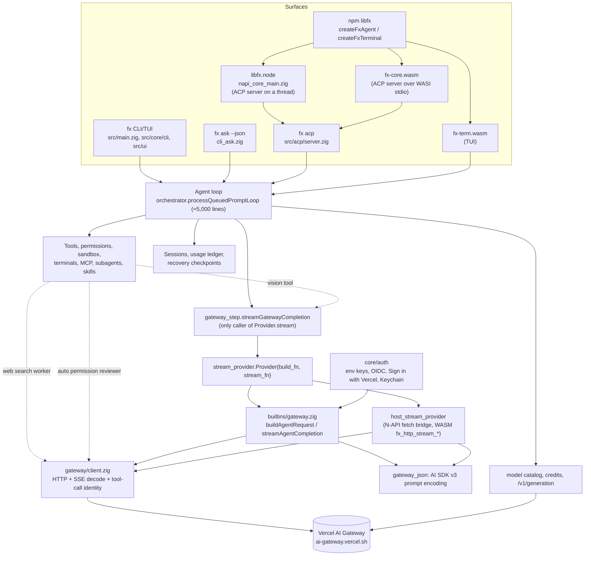

# FX clean-room architecture

Canonical architecture document for the FX rebuild. It describes what exists at commit `255c6cf` (with evidence), the primitives the rebuild keeps, and their exact contracts. Supporting detail is in [audit/](audit/), the capability ledger in [CAPABILITIES.md](CAPABILITIES.md), and the PR sequence in [ROADMAP.md](ROADMAP.md).

## 1. Answers to the five questions

**1. What does FX do today?** It is a complete coding-agent product: a 7.8 MiB Zig CLI/TUI, an ACP server, an N-API addon and two WASI modules. All of them run the same in-process agent loop (`src/core/agent/runtime/orchestrator.zig`) against exactly one inference backend, Vercel AI Gateway, over the AI SDK `LanguageModelV3` protocol implemented natively in Zig (`src/gateway/client.zig`). It also owns tools, permissions, an OS sandbox (macOS only), hosted terminals, background processes, MCP, subagents, skills, sessions, Vercel sign-in, a model catalog, credits, billing reconciliation and self-upgrade. Every file and declaration is inventoried in [inventory/](inventory/).

**2. What is essential, misplaced, redundant, incidental, broken or obsolete?**

| Class | Examples (details in the ledger) |
| --- | --- |
| Essential inference behavior | typed messages and parts, incremental text/reasoning/tool-input streaming, tool-call proposals with identity and integrity validation, provider-executed tool records, finish-reason vocabulary, usage, delivery certainty, cancellation, history pairing validation |
| Useful but misplaced | retry/recovery policy (Chip), model catalog and capability heuristics (Easy-LLM), credential resolution (Easy-LLM), permission review via a model (Chip), sandbox and process execution (Compute), sessions and usage ledgers (Chip) |
| Redundant | three inference entry paths (agent seam, web-search worker, permission reviewer), two `BuildBudget` and two `StructuredResponseFormat` types, `ProviderAttemptOwner` duplicated in `client.zig`, transport-level and agent-level retries |
| Incidental (Vercel) | Gateway endpoints and headers, `provider/model` slugs, team handling, OIDC/AI Gateway key sources, Sign in with Vercel, credits, `/v1/generation` billing, Vercel Sandbox devbox, Vercel Blob CDN, AI-Gateway changelog drafting |
| Broken or inconsistent | host stream provider lacks tool-input streaming, retry-after and network evidence; native error body read without a cap; `c_allocator` scratch in request encoding; bearer header not zeroed; N-API does native HTTP despite `NAPI.md`; `session/remove` missing on native; WASM advertises `resume`/`close` it does not implement |
| Obsolete | `postGatewayCompletion`, `parseGatewayCompletion` (OpenAI shape), test-only `fetchModelIds*`/`fetchPickerModel*`, `HistoryTurn.compacted_summary` with no producer, retired `vercel`/`just_bash` sandbox backends |

**3. The smallest coherent set of primitives** is three, not six, implemented in Rust (`rust/fx-core`, OD-9): an **Inference Contract** (types, events, errors and the stream state machine, with the capability interface it is executed against), an **Inference Executor** (one attempt: validate, invoke, normalize, account, cancel), and **Runtime Adapters** (N-API and WASM). Stream/lifecycle semantics are part of the contract; observability is a hook on the executor; the capability binding is an interface in the contract implemented by Easy-LLM. §4 explains each merge.

**4. What belongs inside, what stays outside:** §5 (ownership table) and the non-responsibility list of each primitive.

**5. The sequence of PRs:** [ROADMAP.md](ROADMAP.md).

## 2. Current architecture (observed)



Facts the diagram encodes, each with evidence:

- One agent loop serves every surface (`app_agent_runtime.zig:987`, `acp/prompt.zig:602`, `subagent/execution.zig:961`).
- `gateway_step.streamGatewayCompletion` is the sole caller of `Provider.stream` (`gateway_step.zig:56`); the web-search worker (`builtins/gateway.zig:911`) and permission reviewer (`permission_reviewer.zig:214`) bypass the seam.
- The provider is chosen at compile time (`main.zig:430-435`) and bundled with seven non-inference services (`gateway_provider.zig:89-98`).
- Embedding surfaces expose ACP, not inference ([audit/04](audit/04-embedding-build-ci.md) §1).
- The wire protocol is AI SDK `LanguageModelV3` ([evidence/observed-wire.md](evidence/observed-wire.md)).

## 3. Design constraints carried from the audit

1. **Do not create a parallel supported interface.** The Rust `fx_core::Capability` (R2) is the only capability interface new code may target. The Zig `stream_provider.Provider` is frozen as part of the behavioral oracle: no new consumer may adopt it, and it is deleted in R5 together with the migration of its single caller ([ROADMAP.md](ROADMAP.md)).
2. **No provider logic in FX.** Endpoints, headers, model naming, capabilities, options mapping, credentials, catalog, billing and routing all leave FX. FX treats the model reference, generation id and cost as opaque values reported by Easy-LLM.
3. **No retry in FX.** Today retries live in two layers (`ProviderAttemptOwner`). In the target, FX performs exactly one attempt and reports evidence (delivery certainty, error kind, retry-after). Connection-level reattempts while a request is still definitely unsent are a transport concern of Easy-LLM; turn-level recovery is Chip policy (the existing pure `model_response_recovery.decide` moves to Chip unchanged).
4. **Proposals are not execution.** The contract distinguishes `ToolCallProposal` (the model asks) from `ProviderToolRecord` (the provider reports it ran a provider-side tool). FX never executes anything.
5. **Bounded everything.** Event sizes, accumulated content, proposal count and error details have explicit limits; errors form a closed set.
6. **No ambient authority.** FX reads no environment variable, file, keychain or clock-dependent configuration for inference behavior; it has no filesystem, process or socket access of its own. Everything arrives through the request or the capability.

## 4. Primitive model

The brief proposed six primitives. The audit supports three:

| Proposed | Decision | Reason |
| --- | --- | --- |
| 1 Inference Contract | **Keep** as primitive A | |
| 3 Stream and Lifecycle | **Merged into A** | The stream state machine is the contract's terminal-state semantics; separating it would split one invariant set across two modules. |
| 5 Capability Binding | **Merged into A (interface) and Easy-LLM (implementation)** | FX must define the interface it executes against; everything behind it belongs to Easy-LLM. A separate FX "binding" module would become the competing provider layer the constraints forbid. |
| 2 Inference Execution | **Keep** as primitive B | |
| 6 Observability and Evidence | **Merged into B** as a diagnostic hook | The minimum facts (correlation id, timing, terminal cause, usage, reported model) are already produced by B. Persistence belongs to the consumer or PAX. |
| 4 Runtime Adapters | **Keep** as primitive C | Only N-API and WASM exist today; no C ABI is added. |

### Implementation language: Rust (OD-9, decided)

Rust is the implementation language of the rebuilt core. The crate `rust/fx-core` is the **normative** implementation of the contract; the Zig code under `src/` is the **behavioral oracle** during migration and is not a second supported inference core. There is exactly one contract and, from R2 on, exactly one executor. See [RUST_PRIMITIVES.md](RUST_PRIMITIVES.md) for the design and [DECISIONS.md](DECISIONS.md) OD-9 for the decision record.

Crate layout (R1 implements the modules marked R1; the rest land in the step named):

| Module | Content | Lands in |
| --- | --- | --- |
| `contract.rs` | semantic types, `Limits`, `DeliveryCertainty`, `ErrorKind`, outcomes | R1 (this tree) |
| `validate.rs` | deterministic request validation, event bound checks | R1 |
| `wire.rs` | versioned JSON boundary encoding (private boundary types, strict decoding) | R1 |
| `json_check.rs`, `base64.rs`, `redact.rs` | bounded JSON syntax check, canonical base64, secret masking for `Detail` | R1 |
| `capability.rs` | the one-attempt `Capability` trait (start, bounded poll, cancel, close) | R2 |
| `executor.rs`, `normalize.rs`, `diagnostics.rs` | state machine, event normalization, bounded redacted diagnostics | R2 |
| `adapters/napi.rs`, `adapters/wasm.rs` | host adapters | R4 |

Dependency policy, enforced by `rust/fx-core/check-boundaries.sh` and `.github/workflows/rust-core.yml`:

- Normal and build dependencies are limited to `rust/fx-core/deps-allowlist.txt`: `serde`, `serde_json` (exact pins) and their transitive crates. Serde is used only inside `wire.rs` for boundary encoding; no public contract type implements `Serialize` or `Deserialize`.
- Forbidden in the graph: provider SDKs, HTTP/TLS clients, async runtimes, `libc`/`nix`, `wasm-bindgen`/`napi` families (adapters bring their own dependencies in their own crates or features in R4).
- Forbidden in `src/`: `std::net`, `std::fs`, `std::process`, `std::env`, `std::thread`, `std::os`, `Instant`, `SystemTime`, `async`/`.await`, `unsafe` (also `#![forbid(unsafe_code)]` via lints), `include!`-family macros and `#[path]`.
- Toolchain pinned in `rust-toolchain.toml` (1.97.0, with `rustfmt`, `clippy` and the `wasm32-unknown-unknown` target); dependencies locked in `rust/fx-core/Cargo.lock`; every gate runs with `--locked`.

### Primitive A: Inference Contract (`rust/fx-core/src/contract.rs`)

**Responsibility:** the provider-neutral vocabulary of one inference operation: request, content parts, tool definitions and choice, generation options, stream events, completion, failure, cancellation, delivery certainty, limits, and (R2) the capability interface it is executed against.

**Not responsible for:** choosing or resolving models; credentials; endpoints; provider wire encoding; retries; agent prompts; tool execution; sessions; persistence; user-facing text.

The Rust types are normative; the summary below is for orientation:

| Concept | Rust type | Notes |
| --- | --- | --- |
| Version | `CONTRACT_VERSION = 1` | `"v"` in every wire document |
| Limits | `Limits` (`Limits::DEFAULT`) | the single place for every bound; defaults cite the oracle where it has one |
| Model | `ModelRef(String)` | opaque; syntax and length only |
| Request | `Request { model, messages, tools, tool_choice, options, correlation, budget }` | |
| Message | `Message { role: Role, parts: Vec<Part>, cache: CacheHint }` | `Role` = System, User, Assistant, Tool |
| Content | `Part::{Text, Image(ImageData), ToolCall(ToolCallProposal), ToolResult(ToolResult)}` | images are bytes plus `ImageMediaType` (PNG, JPEG, GIF, WebP), never paths or URLs |
| Tools | `ToolDefinition { name, description, input_schema_json, execution: Client \| Provider, provider_args_json }`; `ToolChoice::{Auto, None, Required, Named}` | |
| Proposals vs execution | `ToolCallProposal` (model asks; no authority) vs `ProviderToolRecord` (provider reports it ran a provider tool) | invariants 5 and 6 |
| Options | `GenerationOptions { max_output_tokens, reasoning: ReasoningEffort::{Default, Named}, speed: Speed, response_format }` | reasoning labels are opaque catalog labels (oracle `types.zig:1561`) |
| Correlation | `Correlation { request_id: RequestId([u8; 16]), affinity_key }` | forwarded, never interpreted |
| Deadline | `AttemptBudget(Duration)` | a portable duration; the adapter converts it to a host-local deadline. No monotonic instant is ever serialized |
| Events | `Event::{Metadata, TextDelta, ReasoningDelta, ToolInputStart, ToolInputDelta, ToolInputEnd, ToolCall, ProviderToolRecord, Usage, Finish}` | streamed tool input is display only |
| Finish | `FinishReason::{Stop, Length, ContentFilter, ToolCalls, ProviderError, Other}` | oracle `types.zig:915` |
| Usage | `Usage { input, output, cache_read, cache_write, reasoning tokens, cost }` | absent means unknown; cost is an opaque string |
| Delivery | `DeliveryCertainty::{DefinitelyUnsent < PossiblySent < ConfirmedResponse}` | `advance` is monotonic; `may_have_executed` is false only for `DefinitelyUnsent` |
| Errors | `ErrorKind` (14 closed values), `FailureOrigin::{Executor, Capability}`, `CapabilityError`, bounded and masked `Detail` | see §8 |
| Outcomes | `Outcome::{Completed(Completion), Failed(Failure), Cancelled(Cancellation)}` | an interrupted stream is `Failed` with `partial` output; `Cancellation.remote` records what is known about remote cancellation |

Deliberate deviations from the illustrative list in RUST_PRIMITIVES.md §11, both to preserve oracle behavior: `ErrorKind` keeps `ProviderUnavailable` and `SystemResumed` separate from `Transport`, because turn-level recovery distinguishes them (`model_response_recovery.zig` `FailureCause`); and the outcome has no separate "interrupted" variant, matching RUST_PRIMITIVES §5's three outcomes, with interruption expressed as `Failed { partial: Some(..) }`.

**Stream state machine and invariants I1-I10** (enforced by the executor's normalizer in R2, not trusted from the capability):

```text
Open ──metadata*, text_delta*, reasoning_delta*, tool_input_*, tool_call*, provider_tool_record*, usage*──▶ Open
Open ──finish──▶ Finished (terminal)
Open ──capability error──▶ Failed (terminal)
Open ──capability ends without finish──▶ Failed { partial } (interrupted)
Any terminal ──any further event──▶ protocol violation; the first terminal outcome is kept
```

- I1 exactly one terminal outcome per execution; events after it are dropped (`consumeSseStream ignores conflicting and late stream events without mutation`).
- I2 `finish` is authoritative; the executor returns without waiting for transport framing (`consumeSseStream returns immediately after valid finish without waiting for done`).
- I3 a stream that ends without `finish` is interrupted with the partial content preserved (`consumeSseStream preserves partial content without finish proof at EOF`), never a success.
- I4 an unknown finish reason authorizes nothing: on the wire it fails decoding (`event_finish_unknown_reason` fixture); E2E `empty provider finish reason fails closed before tool execution`.
- I5 `tool_input_delta` is never authoritative; the final `tool_call` input wins; fallback to streamed input only for an exactly matching, ended stream of the same name (`consumeSseStream accepts authoritative final input before end`, `... rejects fallback from an open stream`, `... rejects a final tool name that conflicts with streamed identity`).
- I6 arguments are always valid JSON after normalization; malformed input is replaced by `{}` and flagged (`consumeSseStream replaces malformed trailing or duplicate-key serialized final input with safe JSON`).
- I7 duplicate proposal ids are preserved and then rejected by admission, never merged (`consumeSseStream preserves duplicate final ids for duplicate admission`).
- I8 provider tool results attach only to provider-executed calls with an unambiguous id (`consumeSseStream rejects provider results for local calls`, `... rejects ambiguous provider result correlation`).
- I9 delivery certainty only moves forward (`delivery certainty stays definitely unsent when request setup fails`, `... becomes possibly sent before response head`; Rust: `delivery_certainty_is_monotonic`).
- I10 history validation: every assistant tool call has exactly one later matching tool result (oracle `validateToolMessageHistory`; Rust: `validate_request`).

### Contract invariants frozen by R1

These are the ten invariants the R1 PR establishes for all later work; each maps to named tests in [BEHAVIOR_MATRIX.md](BEHAVIOR_MATRIX.md) §8.

1. One contract version and one typed semantic model (`contract.rs`); JSON shapes exist only inside `wire.rs`.
2. Invalid requests are rejected before any capability call (`parse_request` = decode + `validate_request`; the executor in R2 must call it first).
3. Delivery certainty is monotonic: `DefinitelyUnsent → PossiblySent → ConfirmedResponse`.
4. Cancellation never implies that the remote operation did not execute.
5. Tool proposals are data, not execution authority.
6. Provider-executed tool records remain distinct from model proposals.
7. All public input sizes and collection counts have explicit bounds in `Limits`.
8. No credentials, prompts, image bytes, tool arguments or full provider error bodies appear in errors or diagnostics.
9. No ambient network, filesystem, process, credential or configuration access exists in the core.
10. No host-specific type leaks into the contract.

### Validation ownership

| Check | Owner | Where |
| --- | --- | --- |
| Byte size of documents, before parsing | FX | `wire::decode_*` (`Limits.max_request_bytes`, `max_event_bytes`) |
| UTF-8, JSON syntax, version, tags, enum values, unknown/duplicate/missing fields, trailing data | FX | `wire::decode_*` |
| Model id syntax and length (opaque otherwise) | FX | `validate_request` |
| Whether the model exists, is permitted, or supports the options | Easy-LLM | capability; reported as `ModelUnavailable` / `InvalidRequest` |
| Message count, part count, role/content combinations, total text | FX | `validate_request` |
| Tool-call/result pairing, duplicate ids, name agreement (oracle rules) | FX | `validate_request` |
| Tool names, ids, description/schema/argument bounds, duplicate tool names, named-choice existence | FX | `validate_request` |
| JSON syntax of schemas, arguments, provider args and JSON tool output (strict RFC 8259, duplicate keys rejected, depth-bounded) | FX | `validate_request` via `json_check` |
| JSON Schema *semantics* of tool and response schemas | not FX | Chip (tool schemas it authors), Easy-LLM (provider mapping) |
| Mapping `response_format` to provider structured-output features; checking completed output against the schema | Easy-LLM / caller | FX does not validate completed output against the schema (single validation authority) |
| Image media type sniffing against declared type, per-image, count and total bounds | FX | `validate_request` |
| Reasoning label syntax; whether the model supports the label | FX syntax; Easy-LLM support | |
| Capability event field bounds | FX | `validate_event_bounds` (decode) |
| Event semantics: ordering, terminal rules, proposal identity, malformed-argument replacement | FX executor | R2 normalizer |
| Tool-call admission for execution (permission) | Chip / Attn | never FX |

### Primitive B: Inference Executor (`rust/fx-core/src/executor.rs`, R2)

**Responsibility:** run exactly one inference attempt against a supplied capability: validate (via `parse_request`/`validate_request`), start the capability once, poll bounded batches, normalize events (I1-I10), forward them, accumulate the bounded completion, enforce cancellation and the attempt budget, and produce exactly one `Outcome` with redacted diagnostics.

**Not responsible for:** retries, fallback, model or provider choice, credentials, prompt assembly, history budgeting, tool admission or execution, persistence, usage ledgers, user-facing wording.

The capability shape is the non-blocking, host-drivable trait in RUST_PRIMITIVES.md §6 (`start`, bounded `poll`, `cancel`, `close`); it lands in R2 with the fake capability. Diagnostics (formerly primitive 6) are bounded metadata only: request id, timing, terminal cause, event and byte counts, and a content-free request-shape summary (today's `formatGatewayRequestShapeSummary`).

### Primitive C: Runtime Adapters (R4)

Shared rule: adapters translate types and lifetimes only. They do not add retries, defaults or validation beyond the executor's, they reuse `wire.rs` for JSON, and they run the same fixtures (`rust/fx-core/tests/fixtures/contract/` and the R2 executor fixtures).

- **Native Rust API.** The `fx-core` crate itself. Rust consumers link it directly; the Zig shell reaches it through the C-compatible boundary chosen in R4/R5 (opaque handles, fixed-width scalars, pointer/length pairs, Rust-owned buffers with a matching free; RUST_PRIMITIVES §11).
- **N-API (`libfx.node`, `libfxApiVersion = 3`).** `createInference({capability})`, `execute(request, {signal})` returning ordered events and one outcome; type-tagged handles with slot caps and exactly-once destruction (kept from `napi_core_main.zig`); thread-safe notification instead of 2 ms polling; capability source per OD-3. The N-API binding crate is an adapter dependency decision for R4 and stays out of `fx-core`'s graph.
- **WASM (`fx-core.wasm`, `wasm32-unknown-unknown`).** A host-driven reactor: `fx_create`, `fx_begin`, `fx_push_event`, `fx_poll`, `fx_cancel`, `fx_close`, `fx_last_error` (RUST_PRIMITIVES §10). No WASI, filesystem, sockets, threads, JSPI or suspending imports. R1 already builds the contract for `wasm32-unknown-unknown` in CI.

### Event and request encoding across process or language boundaries

The versioned JSON encoding is implemented once, in `rust/fx-core/src/wire.rs`, with round-trip and strict-rejection tests. Requests are flat objects with `"v"`; events, outcomes and capability errors are `{"v":1,"event"|"outcome"|"error":{...}}` envelopes; tagged unions use `"type"`. It is an encoding of the contract, not a second API: boundary types are private, and no field exists in JSON that does not exist in the Rust types.

## 5. Ownership boundaries

| Responsibility | Owner | Evidence of current location |
| --- | --- | --- |
| Request/result/event/error contract; one-attempt execution; stream normalization; proposal validation; cancellation; deadlines; diagnostics data | **FX** | `stream_provider.zig`, `gateway_step.zig`, `client.zig` normalization, `types.zig` completion types, `gateway_json.validateToolMessageHistory` |
| N-API and WASM adapters for the above | **FX** | `napi_core_main.zig`, `napi_fetch_state.zig`, `wasm_core_main.zig`, `js_host_stream_provider.zig` |
| Wire protocols, endpoints, headers, SSE framing, model naming, capabilities, provider options, catalog, credentials, login, keychain, teams/tenancy, credits, billing reconciliation, routing, health, fallback, transport-level reattempts | **Easy-LLM** | `src/gateway/*`, `src/core/gateway/*`, `src/core/auth/*`, `builtins/gateway.zig`, `model_capabilities.zig`, `model_cache_runtime.zig` |
| Agent loop, recovery policy, prompt assembly, history budgeting, tools (definitions, admission, execution), permission review via a model, subagents, MCP, skills, hooks, sessions, usage ledgers, ACP | **Chip** | `src/core/agent/**`, `src/core/tooling/*`, `src/tools/**`, `src/core/session/*`, `src/acp/*`, `src/core/{subagent,mcp,skills,hooks,modes,tasks}` |
| Processes, PTYs, hosted terminals, background lifecycle, sandbox enforcement, remote execution, host workspace exec | **Compute** | `src/core/{execution,background,terminal,shell_command}`, `permissions/sandbox.zig`, `hosts/js_host_workspace.zig`, `devbox_executor.zig` |
| Application authority (who may approve what) | **Attn** (boundary with Chip is OD-4) | `src/core/permissions/*` policy parts |
| Durable evidence | **Consumer / PAX** | today: `session_usage.zig`, recovery checkpoints, `/trace` |
| CLI/TUI product shell | **Undecided (OD-1)** | `src/ui`, `src/core/{app,cli,input,output,slash_commands}`, `src/main.zig` |

No component in this table owns two conflicting roles. FX holds no provider registry, routing engine, credential store or model catalog.

## 6. Target dependency diagram


Logical ownership versus physical boundaries:

- Native: Chip, FX and Easy-LLM link into one process; `Capability.run` is a direct call. No IPC.
- Node: FX and possibly Easy-LLM inside `libfx.node`; if Easy-LLM is a JS library, it is passed in as a host capability (OD-3).
- Browser: FX is a reactor WASM module; Easy-LLM runs in the page (or in a worker) and pushes events.
- A versioned local IPC boundary is introduced only if Easy-LLM must run in a separate process. It would carry exactly the JSON encoding of §4 and nothing else.

Attn and Compute have no edge into FX. FX has no edge into Chip, Compute or Attn.

## 7. WASM execution modes

| Mode | What it requires | Present today? | Plan |
| --- | --- | --- | --- |
| Remote | a host capability that reaches a remote backend | Yes, as host `fetch` to Vercel AI Gateway (`fx_http_stream_*`) | Supported by the reactor design with Easy-LLM in the host. |
| CPU in WASM | a model runtime and weights executing inside the WASM sandbox | **No.** The repository contains no tensor code, model loader, tokenizer or weights; the WASM build is `single_threaded` and `wasm32` (4 GiB address space) | Not promised. The contract does not prevent it: an in-guest capability could implement `Capability` and run inside the same module, but that is Easy-LLM's work and needs its own memory and threading evaluation. |
| Accelerated via host | an explicitly granted host capability for tensor execution (for example WebGPU or WebNN in the page) | No | Same as CPU: the host implements `Capability` (or Easy-LLM does inside the host) and pushes events; FX only needs the event stream. |

The contract makes the three modes interchangeable because FX never sees how events were produced. Remote inference is not mandatory: no FX code path assumes a network.

## 8. Error taxonomy mapping from today

Target values are the wire spellings of `fx_core::ErrorKind`. HTTP status, provider codes, retry-after parsing and body caps are Easy-LLM transport concerns; FX receives the normalized `CapabilityError`.

| Current signal (evidence) | Target `ErrorKind` |
| --- | --- |
| `InvalidGatewayHistory`, `InvalidStructuredResponseSchema`, `MissingStructuredResponseFormat`, `StructuredResponseRequiresVerifiedImages` (`gateway_json.zig`, `builtins/gateway.zig`) | `invalid_request` |
| HTTP 400/422 | `invalid_request` (status in `status_hint`) |
| HTTP 401 / missing credential (`MissingCredentials`) | `unauthenticated` |
| HTTP 403 | `forbidden` |
| HTTP 404 on model | `model_unavailable` |
| HTTP 429 with `retry-after` (`client.zig:1830`) | `rate_limited` + `retry_after` |
| HTTP 5xx (`delivery_ambiguous`) | `provider_unavailable`, `possibly_sent` |
| `finish{error}` / `content-filter` | `completed` with `finish_reason = provider_error / content_filter`, disposition `provider_failure` (not a transport failure) |
| `ConnectionReset`, `ConnectionTimedOut`, TLS, DNS, `ReadFailed`, `WriteFailed` (`networkFailureEvidence`) | `transport` |
| `SystemResumed` | `system_resumed` |
| `Timeout` (bounded operations) | `timeout` |
| `Cancelled` | `cancelled` |
| `InvalidProviderFinishReason`, `GatewaySseReadStalled` | `protocol_violation` |
| `GatewaySseEventTooLarge`, `GatewayGenerationResponseTooLarge` | `resource_limit` |
| `AgentStreamProviderUnavailable`, `HostStreamFailed`, `JsHostStreamFailed` | `capability_unavailable` |
| `OutOfMemory` | `internal` (Rust aborts on allocation failure by default; bounded inputs make it a defect, not a runtime path) |

`InvalidE2EGatewayUrl`, `InvalidGenerationId` and the catalog errors move to Easy-LLM with their callers.

## 9. Cancellation and cleanup guarantees

- C1 Cancel before start performs validation-only work and returns `Cancelled { delivery: DefinitelyUnsent, remote: NotStarted }` without calling the capability (today: `direct gateway cancellation before admission opens no connection`).
- C2 Cancel during the capability call: the executor calls the capability's `cancel` and stops forwarding; the outcome is `Cancelled` with the delivery certainty recorded so far and `remote = Unconfirmed` unless the capability confirms. Cancellation never claims the remote operation did not run (invariant 4).
- C3 Cancel during streaming: events already forwarded remain valid for the observer; no events are forwarded after cancel is observed; partial content is carried in `Cancellation.partial`.
- C4 Double cancel is a no-op; cancel after a terminal outcome is a no-op.
- C5 Consumer abandonment is equivalent to C2/C3, and cleanup is bounded even when the capability cannot interrupt the provider.
- C6 Every path releases all per-execution state (Rust ownership plus explicit capability `close`); the oracle's allocation-failure sweep (`consumeSseStream frees all response state across allocation failures`) is ported as resource-teardown tests on every terminal path.
- C7 The deadline is absolute; progress never extends it (`bounded gateway progress does not extend the absolute deadline`).

## 10. Security assumptions

- FX handles no credential. A capability that needs one obtains it from Easy-LLM's own store.
- `Request` content is caller data and may contain secrets; FX never logs it. `Detail` is masked (port of the oracle's `maskSecrets` patterns, `rust/fx-core/src/redact.rs`) and bounded to `Limits.max_detail_bytes`.
- All sizes are bounded (`Limits`), including event size, proposal count and detail length.
- FX performs no filesystem, process or network access. The WASM module imports nothing that grants it.
- Model output is data. Proposals carry no authority; `admitProposals` only checks structural validity, never permission.
- N-API keeps type-tagged handles, slot caps and idempotent destroy.

## 11. Versioning and compatibility

- `fx_core::CONTRACT_VERSION` (Rust), `"v"` (JSON), `libfxApiVersion` (N-API) and a WASM export `fx_contract_version()` move together. Additive changes (new optional field, new event variant that older consumers may ignore) bump the minor documented version; removing or changing semantics bumps `contract_version`.
- The npm package major version changes when the rebuilt core replaces `createFxAgent` (an intentional breaking release; see R-1 in [RISKS.md](RISKS.md)).
- The product shell's public contracts (`fx ask --json`, `fx status --json`, ACP) are outside FX and keep their own compatibility policy with their owner.
