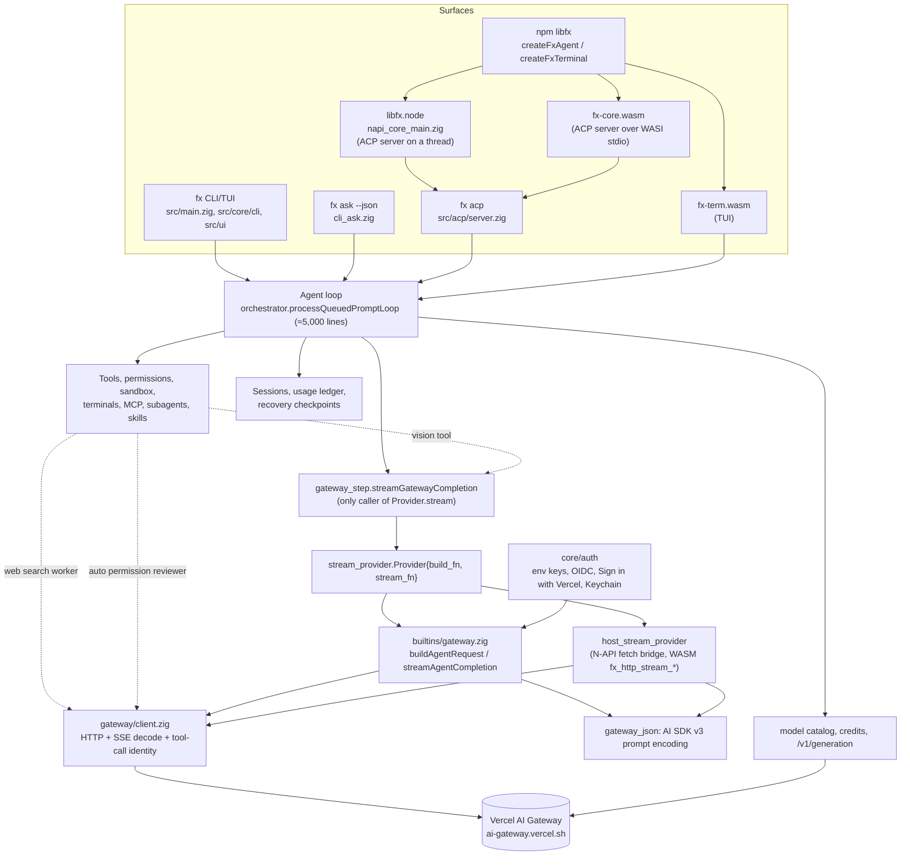
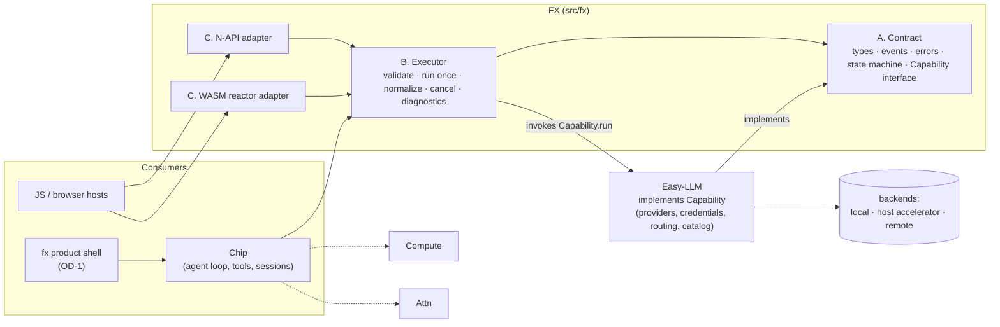

# FX clean-room architecture

Canonical architecture document for the FX rebuild. It describes what exists at commit `255c6cf` (with evidence), the primitives the rebuild keeps, and their exact contracts. Supporting detail is in [audit/](audit/), the capability ledger in [CAPABILITIES.md](CAPABILITIES.md), and the PR sequence in [ROADMAP.md](ROADMAP.md).

## 1. Answers to the five questions

**1. What does FX do today?** It is a complete coding-agent product: a 7.8 MiB Zig CLI/TUI, an ACP server, an N-API addon and two WASI modules. All of them run the same in-process agent loop (`src/core/agent/runtime/orchestrator.zig`) against exactly one inference backend, Vercel AI Gateway, over the AI SDK `LanguageModelV3` protocol implemented natively in Zig (`src/gateway/client.zig`). It also owns tools, permissions, an OS sandbox (macOS only), hosted terminals, background processes, MCP, subagents, skills, sessions, Vercel sign-in, a model catalog, credits, billing reconciliation and self-upgrade. Every file and declaration is inventoried in [inventory/](inventory/).

**2. What is essential, misplaced, redundant, incidental, broken or obsolete?**

| Class | Examples (details in the ledger) |
| --- | --- |
| Essential inference behavior | typed messages and parts, incremental text/reasoning/tool-input streaming, tool-call proposals with identity and integrity validation, provider-executed tool records, finish-reason vocabulary, usage, delivery certainty, cancellation, history pairing validation |
| Useful but misplaced | retry/recovery policy (Chip), model catalog and capability heuristics (Easy-LLM), credential resolution (Easy-LLM), permission review via a model (Chip), sandbox and process execution (Compute), sessions and usage ledgers (Chip) |
| Redundant | three inference entry paths (agent seam, web-search worker, permission reviewer), two `BuildBudget` and two `StructuredResponseFormat` types, `ProviderAttemptOwner` duplicated in `client.zig`, transport-level and agent-level retries |
| Incidental (Vercel) | Gateway endpoints and headers, `provider/model` slugs, team handling, OIDC/AI Gateway key sources, Sign in with Vercel, credits, `/v1/generation` billing, Vercel Sandbox devbox, Vercel Blob CDN, AI-Gateway changelog drafting |
| Broken or inconsistent | host stream provider lacks tool-input streaming, retry-after and network evidence; native error body read without a cap; `c_allocator` scratch in request encoding; bearer header not zeroed; N-API does native HTTP despite `NAPI.md`; `session/remove` missing on native; WASM advertises `resume`/`close` it does not implement |
| Obsolete | `postGatewayCompletion`, `parseGatewayCompletion` (OpenAI shape), test-only `fetchModelIds*`/`fetchPickerModel*`, `HistoryTurn.compacted_summary` with no producer, retired `vercel`/`just_bash` sandbox backends |

**3. The smallest coherent set of primitives** is three, not six: an **Inference Contract** (types, events, errors and the stream state machine, with the capability interface it is executed against), an **Inference Executor** (one attempt: validate, invoke, normalize, account, cancel), and **Runtime Adapters** (N-API and WASM). Stream/lifecycle semantics are part of the contract; observability is a hook on the executor; the capability binding is an interface in the contract implemented by Easy-LLM. §4 explains each merge.

**4. What belongs inside, what stays outside:** §5 (ownership table) and the non-responsibility list of each primitive.

**5. The sequence of PRs:** [ROADMAP.md](ROADMAP.md).

## 2. Current architecture (observed)



Facts the diagram encodes, each with evidence:

- One agent loop serves every surface (`app_agent_runtime.zig:987`, `acp/prompt.zig:602`, `subagent/execution.zig:961`).
- `gateway_step.streamGatewayCompletion` is the sole caller of `Provider.stream` (`gateway_step.zig:56`); the web-search worker (`builtins/gateway.zig:911`) and permission reviewer (`permission_reviewer.zig:214`) bypass the seam.
- The provider is chosen at compile time (`main.zig:430-435`) and bundled with seven non-inference services (`gateway_provider.zig:89-98`).
- Embedding surfaces expose ACP, not inference ([audit/04](audit/04-embedding-build-ci.md) §1).
- The wire protocol is AI SDK `LanguageModelV3` ([evidence/observed-wire.md](evidence/observed-wire.md)).

## 3. Design constraints carried from the audit

1. **Do not create a parallel interface.** `stream_provider.Provider` is replaced in place: the PR that introduces the new capability interface also migrates its single caller and deletes the old type ([ROADMAP.md](ROADMAP.md), PR 3).
2. **No provider logic in FX.** Endpoints, headers, model naming, capabilities, options mapping, credentials, catalog, billing and routing all leave FX. FX treats the model reference, generation id and cost as opaque values reported by Easy-LLM.
3. **No retry in FX.** Today retries live in two layers (`ProviderAttemptOwner`). In the target, FX performs exactly one attempt and reports evidence (delivery certainty, error kind, retry-after). Connection-level reattempts while a request is still definitely unsent are a transport concern of Easy-LLM; turn-level recovery is Chip policy (the existing pure `model_response_recovery.decide` moves to Chip unchanged).
4. **Proposals are not execution.** The contract distinguishes `ToolCallProposal` (the model asks) from `ProviderToolRecord` (the provider reports it ran a provider-side tool). FX never executes anything.
5. **Bounded everything.** Event sizes, accumulated content, proposal count and error details have explicit limits; errors form a closed set.
6. **No ambient authority.** FX reads no environment variable, file, keychain or clock-dependent configuration for inference behavior; it has no filesystem, process or socket access of its own. Everything arrives through the request or the capability.

## 4. Primitive model

The brief proposed six primitives. The audit supports three:

| Proposed | Decision | Reason |
| --- | --- | --- |
| 1 Inference Contract | **Keep** as primitive A | |
| 3 Stream and Lifecycle | **Merged into A** | The stream state machine is the contract's terminal-state semantics; separating it would split one invariant set across two modules. |
| 5 Capability Binding | **Merged into A (interface) and Easy-LLM (implementation)** | FX must define the interface it executes against; everything behind it belongs to Easy-LLM. A separate FX "binding" module would become the competing provider layer the constraints forbid. |
| 2 Inference Execution | **Keep** as primitive B | |
| 6 Observability and Evidence | **Merged into B** as a diagnostic hook | The minimum facts (correlation id, timing, terminal cause, usage, reported model) are already produced by B. Persistence belongs to the consumer or PAX. |
| 4 Runtime Adapters | **Keep** as primitive C | Only N-API and WASM exist today; no C ABI is added. |

Physical layout proposal: one Zig module `fx` rooted at `src/fx/root.zig` with `contract.zig`, `executor.zig`, `normalizer.zig` and `diagnostics.zig`, plus `src/fx/napi.zig` and `src/fx/wasm.zig` as separate build roots. The module imports only `std` and `src/core/shared/io.zig`.

### Primitive A: Inference Contract (`src/fx/contract.zig`)

**Responsibility:** the provider-neutral vocabulary of one inference operation: request, content parts, tool definitions and choice, generation options, stream events, completion, failure, the capability interface, and the stream state machine rules.

**Not responsible for:** choosing or resolving models; credentials; endpoints; wire encoding; retries; agent prompts; tool execution; sessions; persistence; user-facing text.

```zig
pub const contract_version: u32 = 1;

pub const ModelRef = struct { id: []const u8 }; // opaque; interpreted only by the capability

pub const Role = enum { system, user, assistant, tool };

pub const CacheHint = enum { default, no_cache, breakpoint };

pub const Part = union(enum) {
    text: []const u8,
    image: struct { media_type: []const u8, data: []const u8 }, // verified bytes, never a path
    tool_call: ToolCallProposal,   // assistant messages only
    tool_result: ToolResult,       // tool messages only
};

pub const ToolResult = struct {
    call_id: []const u8,
    name: []const u8,
    output: union(enum) { text: []const u8, json: []const u8, failure: []const u8 },
};

pub const Message = struct { role: Role, parts: []const Part, cache: CacheHint = .default };

pub const ToolDefinition = struct {
    name: []const u8,
    description: []const u8,
    input_schema_json: []const u8,
    execution: enum { client, provider } = .client,
    provider_args_json: ?[]const u8 = null, // provider tools only; opaque to FX
};

pub const ToolChoice = union(enum) { auto, none, required, named: []const u8 };

/// Today's types.ReasoningEffort is `auto | named(<catalog-declared label>)` (types.zig:1561);
/// the label set comes from the model catalog, so FX keeps it opaque and Easy-LLM validates it.
pub const ReasoningEffort = union(enum) { default, named: []const u8 };
pub const Speed = enum { standard, fast };

pub const ResponseFormat = struct { name: []const u8, description: []const u8, schema_json: []const u8 };

pub const GenerationOptions = struct {
    max_output_tokens: ?u32 = null,
    reasoning: ReasoningEffort = .default,
    speed: Speed = .standard,
    response_format: ?ResponseFormat = null,
};

pub const Correlation = struct {
    request_id: [16]u8,          // generated by the caller or the executor
    affinity_key: ?[]const u8 = null, // e.g. a session id; forwarded, never interpreted
};

pub const Request = struct {
    model: ModelRef,
    messages: []const Message,
    tools: []const ToolDefinition = &.{},
    tool_choice: ToolChoice = .auto,
    options: GenerationOptions = .{},
    correlation: Correlation,
    deadline: ?std.Io.Clock.Timestamp = null,
};
```

Stream events emitted by the capability and re-emitted (normalized) by the executor:

```zig
pub const Event = union(enum) {
    metadata: struct { model_reported: ?[]const u8, generation_id: ?[]const u8, timestamp_ms: ?i64 },
    text_delta: []const u8,
    reasoning_delta: []const u8,
    tool_input_start: struct { id: []const u8, name: []const u8 },
    tool_input_delta: struct { id: []const u8, delta: []const u8 }, // display only, never authoritative
    tool_input_end: struct { id: []const u8 },
    tool_call: ToolCallProposal,           // authoritative proposal
    provider_tool_result: ProviderToolRecord,
    finish: Finish,                        // terminal (success path)
    failure: Failure,                      // terminal (error path)
};

pub const FinishReason = enum { stop, length, content_filter, tool_calls, provider_error, other };

pub const Usage = struct {
    input_tokens: ?u64 = null, output_tokens: ?u64 = null,
    cache_read_tokens: ?u64 = null, cache_write_tokens: ?u64 = null, reasoning_tokens: ?u64 = null,
};

pub const Finish = struct { reason: FinishReason, usage: ?Usage = null, cost: ?[]const u8 = null }; // cost: decimal string, opaque

pub const ToolCallProposal = struct {
    id: []const u8,
    name: []const u8,
    arguments_json: []const u8,             // always valid JSON after normalization
    integrity: enum { valid, malformed_replaced },
    identity: enum { valid, absent, empty, wrong_type, duplicate, reconciled },
    source: enum { final, streamed_fallback },
};

pub const ProviderToolRecord = struct {
    call_id: []const u8, name: []const u8, input_json: []const u8,
    result_json: ?[]const u8, identity_failure: ?ProviderResultIdentityFailure,
};
```

`ProviderResultIdentityFailure` keeps the 13 cases of `types.zig:579-593`.

Failures form a closed set:

```zig
pub const DeliveryCertainty = enum { definitely_unsent, possibly_sent };

pub const ErrorKind = enum {
    invalid_request,        // FX validation or capability rejected the request shape
    unauthenticated,        // capability could not authenticate (FX never sees why)
    forbidden,
    model_unavailable,      // unknown model or no route
    rate_limited,
    provider_unavailable,   // 5xx-class, overloaded
    transport_interrupted,
    system_resumed,
    timeout,                // request deadline reached
    cancelled,
    protocol_violation,     // malformed event order, invalid finish, oversize event
    response_too_large,
    capability_unavailable,
    out_of_memory,
};

pub const Failure = struct {
    kind: ErrorKind,
    delivery: DeliveryCertainty,
    retry_after_ms: ?u64 = null,
    status_hint: ?u16 = null,          // diagnostic only (e.g. HTTP status); never a control input
    detail: ?[]const u8 = null,        // bounded (≤600 bytes), secret-masked
};
```

The capability interface (the only thing Easy-LLM implements for FX):

```zig
pub const Control = struct {
    cancel: *std.atomic.Value(bool),
    delivery: *std.atomic.Value(DeliveryCertainty), // monotonic: unsent → possibly_sent only
    pulse: ?CooperativePulse = null,                 // single-threaded hosts
};

pub const Sink = struct {
    ctx: *anyopaque,
    emit: *const fn (ctx: *anyopaque, event: *const Event) Flow, // event memory valid only during the call
};
pub const Flow = enum { @"continue", stop }; // stop = consumer abandonment

pub const Capability = struct {
    ctx: *anyopaque,
    vtable: *const struct {
        /// Executes one attempt. Must emit events in order and end with exactly one
        /// `finish` or `failure`, or return an error before emitting anything terminal.
        run: *const fn (ctx: *anyopaque, gpa: std.mem.Allocator, request: *const Request,
                        control: *const Control, sink: Sink) RunError!void,
    },
};
pub const RunError = error{ OutOfMemory, CapabilityUnavailable };
```

**Stream state machine** (enforced by the executor's normalizer, not trusted from the capability):

```text
Open ──metadata*, text_delta*, reasoning_delta*, tool_input_*, tool_call*, provider_tool_result*──▶ Open
Open ──finish──▶ Finished (terminal)
Open ──failure──▶ Failed (terminal)
Open ──capability returns without a terminal event──▶ Failed{protocol_violation} (or Interrupted, see below)
Any terminal ──any further event──▶ ignored and counted as an anomaly
```

Invariants (each maps to an existing tested behavior; see [BEHAVIOR_MATRIX.md](BEHAVIOR_MATRIX.md)):

- I1 exactly one terminal outcome per execution; events after it are dropped (`consumeSseStream ignores conflicting and late stream events without mutation`).
- I2 `finish` is authoritative; the executor returns without waiting for transport framing (`consumeSseStream returns immediately after valid finish without waiting for done`).
- I3 a stream that ends without `finish` yields `Interrupted` with the partial content preserved (`consumeSseStream preserves partial content without finish proof at EOF`), classified as `interrupted`, never as success.
- I4 an unknown or empty finish reason is a `protocol_violation` and authorizes nothing (`consumeSseStream rejects malformed provider finish reasons`; E2E `empty provider finish reason fails closed before tool execution`).
- I5 `tool_input_delta` is never authoritative; the final `tool_call` input wins; fallback to streamed input only for an exactly matching, ended stream of the same name (`consumeSseStream accepts authoritative final input before end`, `... rejects fallback from an open stream`, `... rejects a final tool name that conflicts with streamed identity`).
- I6 arguments are always valid JSON after normalization; malformed input is replaced by `{}` and flagged (`consumeSseStream replaces malformed trailing or duplicate-key serialized final input with safe JSON`).
- I7 duplicate proposal ids are preserved and then rejected by admission, never merged (`consumeSseStream preserves duplicate final ids for duplicate admission`).
- I8 provider tool results attach only to provider-executed calls with an unambiguous id (`consumeSseStream rejects provider results for local calls`, `... rejects ambiguous provider result correlation`).
- I9 `delivery` only moves from `definitely_unsent` to `possibly_sent` (`delivery certainty stays definitely unsent when request setup fails`, `... becomes possibly sent before response head`).
- I10 history validation: every assistant tool call has exactly one later matching tool result (`validateToolMessageHistory`).

### Primitive B: Inference Executor (`src/fx/executor.zig`)

**Responsibility:** run exactly one inference attempt against a supplied `Capability`: validate and normalize the request, invoke the capability, normalize and bound the event stream, forward events to the caller, accumulate the completion, enforce cancellation and the deadline, classify the outcome, and report diagnostics.

**Not responsible for:** retries, fallback, model or provider choice, credentials, prompt assembly, history budgeting, tool admission or execution, persistence, usage ledgers, user-facing wording.

```zig
pub const Limits = struct {
    max_event_bytes: usize = 32 << 20,       // today's SSE line cap
    max_content_bytes: ?usize = null,        // today's content_capture_limit
    max_proposals: usize = 256,
    max_detail_bytes: usize = 600,
};

pub const Completion = struct {
    content: []const u8,
    reasoning_bytes: usize,                  // reasoning is streamed, counted, not retained (today's behavior)
    proposals: []const contract.ToolCallProposal,
    provider_records: []const contract.ProviderToolRecord,
    finish_reason: contract.FinishReason,
    usage: ?contract.Usage,
    cost: ?[]const u8,
    generation_id: ?[]const u8,
    model_reported: ?[]const u8,
    disposition: Disposition,                // classifyProviderCompletion
    anomalies: u32,
};

pub const Disposition = enum { complete, tool_proposals, length_limited, provider_failure, invalid_completion };

pub const Outcome = union(enum) {
    completed: Completion,
    interrupted: struct { partial: Completion, delivery: contract.DeliveryCertainty },
    failed: contract.Failure,
};

pub const Result = struct {
    arena: std.heap.ArenaAllocator, // owns every slice in `outcome`
    outcome: Outcome,
    diagnostics: Diagnostics,
    pub fn deinit(self: *Result) void;
};

pub fn execute(
    gpa: std.mem.Allocator,
    capability: contract.Capability,
    request: *const contract.Request,
    control: *const contract.Control,
    observer: ?contract.Sink,   // receives normalized events in order; may return .stop
    limits: Limits,
) error{OutOfMemory}!Result;

/// Pure validator used by callers before acting on proposals (today's authoritativeToolAdmission).
pub fn admitProposals(completion: *const Completion) Admission;
```

Behavior:

1. **Validation** before any capability call (delivery stays `definitely_unsent`): non-empty model id; at least one message; role/part compatibility (tool results only in `tool` messages, proposals only in `assistant`); I10 pairing; unique tool definition names; `named` tool choice references a defined tool; `response_format.schema_json` parses as JSON. Failure → `failed{invalid_request, definitely_unsent}`.
2. **Invocation:** exactly one `capability.run`. The executor owns a cancel watcher only for deadline enforcement: when `deadline` passes, it sets `control.cancel` and the outcome is `failed{timeout}`.
3. **Normalization:** the state machine above; bounds from `Limits` (exceeding `max_event_bytes` → `failed{response_too_large}`); proposal normalization I5 to I8; secret masking of `detail`.
4. **Consumer abandonment:** if `observer.emit` returns `.stop`, the executor sets `control.cancel`, waits for `run` to return, and yields `failed{cancelled}` with the current delivery certainty.
5. **Classification:** `Disposition` from `classifyProviderCompletion`; no finish → `interrupted`.
6. **Ownership:** all output memory lives in `Result.arena`; observer events are valid only during the callback. One `Result` per call; no global state; `execute` is safe to call concurrently with distinct `Control` values.

**Diagnostics (merged primitive 6):**

```zig
pub const Diagnostics = struct {
    request_id: [16]u8,
    started_ns: u64, first_event_ns: ?u64, finished_ns: u64,
    terminal_cause: enum { valid_finish, invalid_finish, interrupted, failure, cancelled, deadline, abandoned },
    events: u32, text_bytes: u64, reasoning_bytes: u64, tool_input_bytes: u64,
    request_shape: ShapeSummary, // roles, part counts, tool count, choice; no content (today's formatGatewayRequestShapeSummary)
};
```

The executor also calls an optional `trace` hook with keyless metadata (same policy as `debug_trace.keylessJsonPreview`). It never logs message text, tool arguments, credentials or model output. Durable evidence is the consumer's: the executor's `Diagnostics` is plain data for Chip or PAX to persist.

### Primitive C: Runtime Adapters

Shared rule: adapters translate types and lifetimes only. They do not add retries, defaults or validation beyond what the executor does, and they run the same conformance suite.

**Native Zig API.** The `fx` module itself (A and B). This is what the product shell, and later Chip, import directly. There is no IPC.

**N-API (`src/fx/napi.zig`, artifact `libfx.node`, `libfxApiVersion = 3`).** Exports:

| Function | Behavior |
| --- | --- |
| `createContext({maxConcurrent?})` | Creates an executor context with an owned `std.Io.Threaded`; type-tagged handle (keeps today's `RuntimeHandle` pattern and 64-slot cap) |
| `startInference(ctx, requestJson, capability)` | Validates and starts one execution on a worker thread; returns an inference handle |
| `nextEvents(handle)` | Returns a batch of normalized events and, at the end, the outcome; replaces the 2 ms ACP byte polling with a `napi_threadsafe_function` notification |
| `cancelInference(handle)` | Sets cancel; idempotent |
| `destroyInference(handle)`, `destroyContext(ctx)` | Join and free; idempotent; use after destroy throws `LIBFX_NATIVE_CLOSED` |

The `capability` argument is resolved by OD-3 ([DECISIONS.md](DECISIONS.md)): either Easy-LLM's native capability linked into the addon, or a host capability bridged with today's `FetchBridge` state machine (`napi_fetch_state.zig`) generalized from bytes to events and from one to N concurrent handles. Error codes keep the `LIBFX_*` scheme. ACP byte pipes (`writeCore`, `drainCore`, `closeCore`) are removed.

**WASM (`src/fx/wasm.zig`, artifact `fx-core.wasm`).** A reactor module (no `_start`, no WASI stdio framing):

| Export | Behavior |
| --- | --- |
| `fx_alloc(len) → ptr`, `fx_free(ptr, len)` | Guest-owned buffers |
| `fx_infer_start(request_ptr, request_len) → handle` | Validates and opens an execution |
| `fx_infer_push(handle, event_ptr, event_len) → code` | Host pushes the next capability event (encoded per the contract schema) |
| `fx_infer_poll(handle, out_ptr, out_cap) → len` | Guest returns normalized events and finally the outcome; negative = buffer too small (today's overflow rule) |
| `fx_infer_cancel(handle)`, `fx_infer_close(handle)` | |

Imports: none required beyond `fx_trace` (optional) and `fx_now_ms`. In this design the guest is a pure state machine driven by the host, so **JSPI is no longer required** for inference, filesystem/socket/thread imports are absent, and the module runs in any WebAssembly host. The host obtains events from whatever capability it has (Easy-LLM in JS, a host accelerator, or a remote endpoint). This replaces today's JSPI-dependent `fx_http_stream_*` polling, which assumes FX itself speaks HTTP to a fixed provider.

### Event and request encoding across process or language boundaries

N-API and WASM need a serialized form. It is a versioned JSON schema derived one-to-one from the Zig types (`{"v":1,"type":"text_delta","text":"..."}`, etc.), defined once in `src/fx/contract_json.zig` with round-trip tests. It is an encoding of the contract, not a second API: no field may exist in JSON that does not exist in Zig.

## 5. Ownership boundaries

| Responsibility | Owner | Evidence of current location |
| --- | --- | --- |
| Request/result/event/error contract; one-attempt execution; stream normalization; proposal validation; cancellation; deadlines; diagnostics data | **FX** | `stream_provider.zig`, `gateway_step.zig`, `client.zig` normalization, `types.zig` completion types, `gateway_json.validateToolMessageHistory` |
| N-API and WASM adapters for the above | **FX** | `napi_core_main.zig`, `napi_fetch_state.zig`, `wasm_core_main.zig`, `js_host_stream_provider.zig` |
| Wire protocols, endpoints, headers, SSE framing, model naming, capabilities, provider options, catalog, credentials, login, keychain, teams/tenancy, credits, billing reconciliation, routing, health, fallback, transport-level reattempts | **Easy-LLM** | `src/gateway/*`, `src/core/gateway/*`, `src/core/auth/*`, `builtins/gateway.zig`, `model_capabilities.zig`, `model_cache_runtime.zig` |
| Agent loop, recovery policy, prompt assembly, history budgeting, tools (definitions, admission, execution), permission review via a model, subagents, MCP, skills, hooks, sessions, usage ledgers, ACP | **Chip** | `src/core/agent/**`, `src/core/tooling/*`, `src/tools/**`, `src/core/session/*`, `src/acp/*`, `src/core/{subagent,mcp,skills,hooks,modes,tasks}` |
| Processes, PTYs, hosted terminals, background lifecycle, sandbox enforcement, remote execution, host workspace exec | **Compute** | `src/core/{execution,background,terminal,shell_command}`, `permissions/sandbox.zig`, `hosts/js_host_workspace.zig`, `devbox_executor.zig` |
| Application authority (who may approve what) | **Attn** (boundary with Chip is OD-4) | `src/core/permissions/*` policy parts |
| Durable evidence | **Consumer / PAX** | today: `session_usage.zig`, recovery checkpoints, `/trace` |
| CLI/TUI product shell | **Undecided (OD-1)** | `src/ui`, `src/core/{app,cli,input,output,slash_commands}`, `src/main.zig` |

No component in this table owns two conflicting roles. FX holds no provider registry, routing engine, credential store or model catalog.

## 6. Target dependency diagram



Logical ownership versus physical boundaries:

- Native: Chip, FX and Easy-LLM link into one process; `Capability.run` is a direct call. No IPC.
- Node: FX and possibly Easy-LLM inside `libfx.node`; if Easy-LLM is a JS library, it is passed in as a host capability (OD-3).
- Browser: FX is a reactor WASM module; Easy-LLM runs in the page (or in a worker) and pushes events.
- A versioned local IPC boundary is introduced only if Easy-LLM must run in a separate process. It would carry exactly the JSON encoding of §4 and nothing else.

Attn and Compute have no edge into FX. FX has no edge into Chip, Compute or Attn.

## 7. WASM execution modes

| Mode | What it requires | Present today? | Plan |
| --- | --- | --- | --- |
| Remote | a host capability that reaches a remote backend | Yes, as host `fetch` to Vercel AI Gateway (`fx_http_stream_*`) | Supported by the reactor design with Easy-LLM in the host. |
| CPU in WASM | a model runtime and weights executing inside the WASM sandbox | **No.** The repository contains no tensor code, model loader, tokenizer or weights; the WASM build is `single_threaded` and `wasm32` (4 GiB address space) | Not promised. The contract does not prevent it: an in-guest capability could implement `Capability` and run inside the same module, but that is Easy-LLM's work and needs its own memory and threading evaluation. |
| Accelerated via host | an explicitly granted host capability for tensor execution (for example WebGPU or WebNN in the page) | No | Same as CPU: the host implements `Capability` (or Easy-LLM does inside the host) and pushes events; FX only needs the event stream. |

The contract makes the three modes interchangeable because FX never sees how events were produced. Remote inference is not mandatory: no FX code path assumes a network.

## 8. Error taxonomy mapping from today

| Current signal (evidence) | Target `ErrorKind` |
| --- | --- |
| `InvalidGatewayHistory`, `InvalidStructuredResponseSchema`, `MissingStructuredResponseFormat`, `StructuredResponseRequiresVerifiedImages` (`gateway_json.zig`, `builtins/gateway.zig`) | `invalid_request` |
| HTTP 400/422 | `invalid_request` (status in `status_hint`) |
| HTTP 401 / missing credential (`MissingCredentials`) | `unauthenticated` |
| HTTP 403 | `forbidden` |
| HTTP 404 on model | `model_unavailable` |
| HTTP 429 with `retry-after` (`client.zig:1830`) | `rate_limited` + `retry_after_ms` |
| HTTP 5xx (`delivery_ambiguous`) | `provider_unavailable`, `possibly_sent` |
| `finish{error}` / `content-filter` | `completed` with `finish_reason = provider_error / content_filter`, disposition `provider_failure` (not a transport failure) |
| `ConnectionReset`, `ConnectionTimedOut`, TLS, DNS, `ReadFailed`, `WriteFailed` (`networkFailureEvidence`) | `transport_interrupted` |
| `SystemResumed` | `system_resumed` |
| `Timeout` (bounded operations) | `timeout` |
| `Cancelled` | `cancelled` |
| `InvalidProviderFinishReason`, `GatewaySseReadStalled` | `protocol_violation` |
| `GatewaySseEventTooLarge`, `GatewayGenerationResponseTooLarge` | `response_too_large` |
| `AgentStreamProviderUnavailable`, `HostStreamFailed`, `JsHostStreamFailed` | `capability_unavailable` |
| `OutOfMemory` | `out_of_memory` (returned as a Zig error from `execute`) |

`InvalidE2EGatewayUrl`, `InvalidGenerationId` and the catalog errors move to Easy-LLM with their callers.

## 9. Cancellation and cleanup guarantees

- C1 Cancel before `execute` performs validation-only work and returns `failed{cancelled, definitely_unsent}` without calling the capability (today: `direct gateway cancellation before admission opens no connection`).
- C2 Cancel during the capability call: the capability must observe `control.cancel` and return promptly; the executor returns `failed{cancelled}` with the delivery certainty the capability recorded.
- C3 Cancel during streaming: events already forwarded remain valid for the observer; no events are forwarded after cancel is observed; partial content is available in the failure's companion `interrupted` data when the caller asked for it.
- C4 Double cancel is a no-op; cancel after a terminal outcome is a no-op.
- C5 Consumer abandonment (`Flow.stop`) is equivalent to C2/C3.
- C6 Every path frees all executor memory except the returned `Result.arena`; the allocation-failure fuzz in today's tests (`consumeSseStream frees all response state across allocation failures`) is ported.
- C7 The deadline is absolute; progress never extends it (`bounded gateway progress does not extend the absolute deadline`).

## 10. Security assumptions

- FX handles no credential. A capability that needs one obtains it from Easy-LLM's own store.
- `Request` content is caller data and may contain secrets; FX never logs it. `Failure.detail` is masked with `text_utils.maskSecrets` and bounded.
- All sizes are bounded (`Limits`), including event size, proposal count and detail length.
- FX performs no filesystem, process or network access. The WASM module imports nothing that grants it.
- Model output is data. Proposals carry no authority; `admitProposals` only checks structural validity, never permission.
- N-API keeps type-tagged handles, slot caps and idempotent destroy.

## 11. Versioning and compatibility

- `contract_version` (Zig), `"v"` (JSON), `libfxApiVersion` (N-API) and a WASM export `fx_contract_version()` move together. Additive changes (new optional field, new event variant that older consumers may ignore) bump the minor documented version; removing or changing semantics bumps `contract_version`.
- The npm package major version changes when the rebuilt core replaces `createFxAgent` (an intentional breaking release; see R-1 in [RISKS.md](RISKS.md)).
- The product shell's public contracts (`fx ask --json`, `fx status --json`, ACP) are outside FX and keep their own compatibility policy with their owner.
