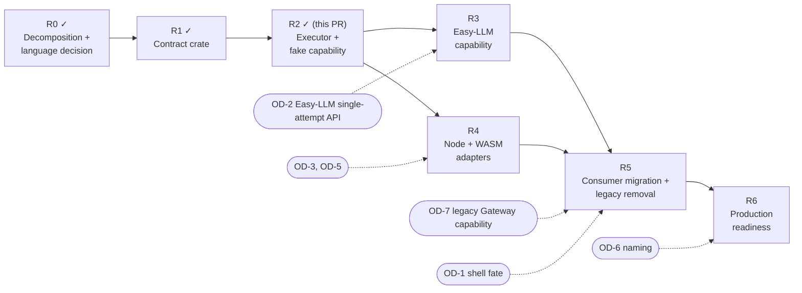

# Implementation roadmap

The rebuild uses the R0–R6 sequence from [RUST_PRIMITIVES.md](RUST_PRIMITIVES.md) §12. Rust is the implementation language of the new core (OD-9). The Zig implementation under `src/` remains the behavioral oracle until R5, and it is never a second supported inference core.

Every PR keeps the existing gates intact: `zig fmt --check src/`, `zig build test`, Full CI on the four native runners, the N-API and WASM SDK lanes, and the ship gate described in `AGENTS.md`. From R1 on, the **Rust core** workflow (`.github/workflows/rust-core.yml`) is an additional gate for any change under `rust/` or to `rust-toolchain.toml`.

## R0: Decomposition and language decision (done)

**Delivered by:** the merged decomposition PRs (`docs/rebuild/`: audits, inventories, capability ledger, behavior matrix, Vercel trace, risks, decisions), `RUST_PRIMITIVES.md`, and the language decision recorded in this PR (OD-9).

**Exit:** one normative design. Architecture, roadmap, README, decisions and risks agree that Rust is normative and Zig is the oracle.

## R1: Contract crate (done)

**Scope**
- `rust-toolchain.toml` (pinned 1.97.0) and `rust/fx-core/` (`Cargo.toml`, `Cargo.lock`, `src/{lib,contract,validate,wire,json_check,base64,redact}.rs`).
- Contract types, the single `Limits` table, deterministic request validation, event bound checks, and versioned strict JSON encoding for requests, events, outcomes and capability errors.
- Deterministic tests: `tests/contract_roundtrip.rs`, `tests/contract_validation.rs`, and `tests/contract_fixtures.rs` with 45 fixtures under `tests/fixtures/contract/`.
- Gates: `cargo fmt --check`, `cargo clippy --locked --all-targets -- -D warnings`, `cargo test --locked`, native and `wasm32-unknown-unknown` release builds, and `check-boundaries.sh` (dependency allowlist, forbidden crates, exact pins, forbidden source patterns). These run on Linux and macOS in `rust-core.yml`.

**Not in scope:** executor, capability trait, Easy-LLM, N-API/WASM ABI, product callers, Gateway deletion, npm changes.

**Exit:** the contract is executable, validated, versioned and bounded. Every R1 behavior maps to a named test (BEHAVIOR_MATRIX §8). Invalid and oversized requests are rejected before any capability could be invoked.

## R2: Executor and fake capability (this PR)

**Delivered**
- `capability.rs`: the non-blocking `Capability` trait (`start`, bounded `poll`, `cancel`, `close`) from RUST_PRIMITIVES §6, with `AttemptContext`, `PollBatch`, `StreamState`, `CancelStatus` and `Started`.
- `executor.rs`: `execute` and `execute_document`, the one-attempt state machine with the `Host` callbacks (`cancel_requested`, `on_event`, `idle`) and `ExecutionReport`.
- `normalize.rs`: invariants I1–I10 over typed events, `classify` (oracle `classifyProviderCompletion`) and `admit_proposals` (oracle `authoritativeToolAdmission`, structural only).
- `diagnostics.rs`: content-free `Diagnostics`, `RequestShape` and `TerminalCause`.
- `testing.rs`: the deterministic `FakeCapability` (scripted start, batches, pending, stall and failures; honest cancel status; recorded invocation counts).
- `Limits` gains `max_events_per_poll`, `max_events_per_attempt` and `max_polls_per_attempt`.
- Tests: `tests/executor.rs` (47 tests across validation and invocation, events and terminal state, delivery certainty, cancellation C1–C5, bounds and diagnostics, isolation) and `tests/executor_fixtures.rs` running 22 oracle-cited fixtures under `tests/fixtures/executor/`.
- `check-boundaries.sh` additionally forbids global mutable state (`static mut`, `thread_local!`, `std::sync`, lazy statics) so concurrent executions stay isolated (BM-11).

**Deferred from the original R2 scope** (recorded in BEHAVIOR_MATRIX §9.4):
- Live oracle replay through a Zig test harness against `consumeSseStream`. It needs Zig changes, and R2 keeps `src/` unchanged; parity is established from the cited oracle tests instead.
- Throughput micro-benchmark (moves to R6 with the other performance gates).
- Wire encoding of `ExecutionReport` (proposal checks, disposition, diagnostics), which moves to R4 with the adapters that need it.

**Dependencies:** R1. OD-8 (malformed-event policy) is already resolved.

**Exit:** deterministic native conformance with no network, credentials or provider dependency.

## R3: Easy-LLM capability

**Scope**
- In `rkendel1/llm`, add a lower-level **single-attempt** API. It must expose the events and terminal semantics FX needs without invoking model fallback or duplicating routing policy. FX does not call the high-level `llm()` function.
- In this repository, add an explicit adapter that implements `fx_core::Capability` over that API. It is a separate crate or feature, so `fx-core`'s dependency allowlist does not grow.
- Collapse the three inference entry paths (agent loop, web-search worker, permission reviewer) onto the executor. Consumer policy stays with its owners.
- If the shell must keep working before Easy-LLM is ready, the legacy Gateway path becomes a consumer-owned capability outside the core, with a fixed deletion PR (OD-7).

**Dependencies:** R2, OD-2.

**Exit:** no compile-time provider choice and no provider implementation inside the FX core.

## R4: Node and WASM adapters

**Scope**
- N-API: `createInference`/`execute`, host-provided capability first (OD-3), thread-safe notification instead of 2 ms polling, type-tagged handles, slot cap, exactly-once destroy, stable `LIBFX_*` errors.
- WASM: a `wasm32-unknown-unknown` reactor ABI with no WASI and no JSPI (OD-5), an import allowlist check, and ABI fuzzing.
- Reuse the R1 and R2 fixtures. Require identical normalized outcomes across native, N-API and WASM (BM-12, BM-14, BM-16).
- A new `libfx` major version. The ACP agent API moves to the consumer package (R-1).

**Dependencies:** R2 (R3 is not required: adapters run against the fake and host capabilities).

**Exit:** equivalent outcomes for every applicable fixture on every runtime.

## R5: Consumer migration and legacy removal

**Scope**
- Migrate the Zig consumers (agent loop, `fx ask`, ACP, vision, web search, permission reviewer) to the Rust executor through the boundary chosen in R4. Then remove `stream_provider.Provider` and `ProviderAttemptOwner`.
- Move recovery policy to Chip, provider concerns to Easy-LLM, and process/sandbox concerns to Compute, per [CAPABILITIES.md](CAPABILITIES.md).
- Execute the removal ledger ([VERCEL_TRACE.md](VERCEL_TRACE.md) §4). Update the PGSO corpus with each E2E move or removal (R-14).
- Do this only after parity is demonstrated: E2E `gateway-stream-lifecycle`, `tui-gateway-stream-lifecycle`, `session-recovery`, `vision-route-fake-gateway`, `web-search-fake-gateway` and `tui-interrupt-recovery` pass unchanged against the new path, and `fx ask --json` against `tools/fake_gateway.py` produces byte-identical output.

**Dependencies:** R3, R4, OD-1, OD-7.

**Exit:** no duplicate seam, no unowned behavior, no unexplained deleted test.

## R6: Production readiness

**Scope**
- Full CI and Rust core CI on every supported runner, recorded at the exact commit.
- ABI/API compatibility notes and migration documentation.
- Benchmarks: startup, memory, event throughput, cancellation latency, binary and WASM size.
- Licenses and notices, including the Rust dependency licenses.
- Release workflow changes from the removal ledger (no Vercel Blob, CDN deploy hook or AI-Gateway changelog drafting).

**Dependencies:** R5, OD-6.

**Exit:** all conformance, performance, security and release gates are green.

## Superseded numbering

The earlier plan numbered six Zig PRs ("PR 1" to "PR 6", with a Zig module at `src/fx/`). That numbering is superseded by R0–R6. The mapping is: PR 1 → R0 + R1, PR 2 → R2, PR 3 → R3, PR 4 → R4, PR 5 → R5, PR 6 → R6. The Zig `src/fx/` module will not be created.
