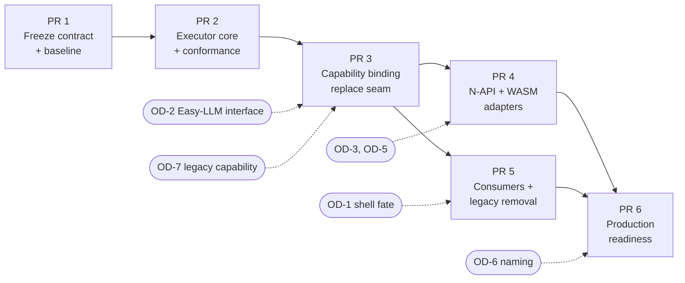

# Implementation roadmap

There are six PRs, in dependency order. Each one can be reviewed, tested and reverted on its own. Every PR follows the repository's existing gates (`AGENTS.md`):
- `zig fmt --check src/` and focused tests
- `./zig-out/bin/fx` exercised on the changed path
- a draft PR
- **Full CI** green on all four runners at the exact commit
- the ship gate

The sequence below adjusts the brief's proposal where the audit justified it:
- PR 1 lands the contract *types*, because the behavior freeze needs something executable to point at.
- PR 3 also collapses the three inference entry paths.
- The legacy Gateway capability (OD-7) bridges PR 3 to PR 5.

## PR 1: Freeze the behavioral contract

**Scope**
- This decomposition (docs and inventory tooling). It is the current PR.
- Add `src/fx/contract.zig` and `src/fx/contract_json.zig`: the types, events, errors and `Capability` interface from [ARCHITECTURE.md](ARCHITECTURE.md) §4 A. Include JSON round-trip tests. There is no executor yet and no caller in the product.
- Add `src/fx/testing/fixtures/`: translate the stream scripts in `client.zig` tests and `gateway-stream-lifecycle.test.ts` into contract-event fixtures, each with the expected outcome from [BEHAVIOR_MATRIX.md](BEHAVIOR_MATRIX.md).
- Add an import-boundary check: a script plus a CI step. It fails if `src/fx/**` imports anything outside `src/fx/` and `src/core/shared/io.zig`.
- Add an invariant-coverage check: every I-, C-, BM- and A- identifier in the docs must name at least one test.
- Run Full CI on the frozen commit and record the authoritative pass/fail set (R-11).

**Dependencies:** none.

**Acceptance**
- The contract compiles under `zig build test` and is not imported by product code.
- The fixture corpus parses.
- The boundary check passes.
- `python3 docs/rebuild/tools/generate_inventory.py --check` passes.

**Exit gate**
- Every current public capability has a disposition (already true: zero unclassified files).
- Retained behavior has a testable contract: types plus fixtures with expected outcomes.

**Rollback:** delete `src/fx/` and the docs. No product behavior changes.

## PR 2: Implement the minimal inference core

**Scope**
- `src/fx/executor.zig`, `normalizer.zig`, `diagnostics.zig` and the fake capability. These implement the validation, the state machine (I1-I10), the cancellation guarantees (C1-C7), `Limits`, `admitProposals` and `Diagnostics`.
- Port the normalizer test groups of `client.zig` ([BEHAVIOR_MATRIX.md](BEHAVIOR_MATRIX.md) §4).
- Port all adversarial cases A-1 to A-13.
- Run an allocation-failure sweep.
- Add an executor micro-benchmark measuring events/s and per-event overhead.
- Remove the duplicate `BuildBudget`, the duplicate `StructuredResponseFormat`, and the dead `postGatewayCompletion`/`parseGatewayCompletion`.

**Dependencies:** PR 1. OD-8 resolved.

**Acceptance**
- BM-01 to BM-11, BM-15 and BM-17 pass against the fake capability.
- No Vercel string, credential type, HTTP type or `std.http` import exists in `src/fx`: checked with `rg -n 'vercel|gateway|std\.http' src/fx`, which must be empty.

**Exit gate:** core execution passes its deterministic suite with no Vercel package or service, and with nothing but the standard library.

**Rollback:** revert the PR. Nothing in the product calls `src/fx` yet.

## PR 3: Bind FX to the inference capability and replace the old seam

**Scope**
- `gateway_step.streamGatewayCompletion` becomes a thin call to `fx.execute`. The usage-ledger begin/complete/fail stays in consumer code around it.
- The agent loop builds `fx.Request` instead of `BuildRequest` plus opaque payload bytes.
- The **web-search worker**, **permission reviewer** and **vision tool** move onto `fx.execute` with structured output, collapsing the three entry paths into one.
- `stream_provider.Provider`, `BuildFn`, `StreamFn` and `ProviderAttemptOwner` (both copies) are deleted in the same PR.
- The existing Gateway client is wrapped as `src/shell/legacy_gateway_capability.zig` (OD-7). It is consumer-owned, implements `Capability`, and keeps today's transport retries inside the capability. Two fixes land there: the bearer is zeroed and the error body is capped (R-12).
- Alternatively, if OD-2 has resolved, Easy-LLM's capability is wired here instead and the legacy wrapper is skipped.
- `model_response_recovery` stays in consumer code (destined for Chip) and is fed from `fx.Failure`.
- Investigate and fix the possible `image_provider` leak.

**Dependencies:** PR 2. OD-2 or OD-7.

**Acceptance**
- `fx ask --json` against [tools/fake_gateway.py](tools/fake_gateway.py) produces byte-identical stdout for the plain and tool scenarios in [evidence/observed-wire.md](evidence/observed-wire.md), and the same request bodies.
- E2E `gateway-stream-lifecycle`, `tui-gateway-stream-lifecycle`, `session-recovery`, `vision-route-fake-gateway`, `web-search-fake-gateway` and `tui-interrupt-recovery` pass unchanged.
- The `gateway_flow.zig` suite passes with the seam replaced.
- BM-06, BM-08 (now through the real consumer) and BM-13 pass.
- `rg -n 'stream_provider\.' src` is empty.

**Exit gate:** FX executes through an explicitly passed capability. There is no compile-time provider choice in FX and no competing provider authority in FX.

**Rollback:** revert. The old seam and its tests come back intact because they are deleted in this same PR.

## PR 4: Rebuild the supported runtime surfaces

**Scope**
- `src/fx/napi.zig`: `libfxApiVersion = 3`, with the inference API from ARCHITECTURE §4 C. The capability source follows OD-3, host-provided first. A threadsafe function replaces 2 ms polling. Handles, the slot cap and the `LIBFX_*` codes are retained. The ACP byte pipes and the native HTTP in the addon are removed.
- `src/fx/wasm.zig`: a reactor module per OD-5. It has no WASI, no JSPI and no session/config/OAuth/workspace/terminal imports.
- `libfx` major version with the inference-level JS API: `createInference({capability})`, `execute(request, {signal})` returning an async iterator of events plus the outcome.
- The ACP agent API (`createFxAgent`) moves to the consumer package (Chip or shell per OD-1). The browser terminal moves with the shell. The Vercel demo packaging (`vercel.json`) is removed.
- Port the N-API scripts (misuse, workers, worker-termination, cancel, fetch-failure, config-isolation).

**Dependencies:** PR 3. OD-3 and OD-5.

**Acceptance**
- BM-12, BM-14 and BM-16 pass. Every fixture produces identical outcome JSON on native, N-API and WASM.
- The WASM import allowlist check passes.
- No CLI spawn exists on any surface.

**Exit gate:** every retained runtime surface passes the same conformance suite.

**Rollback:** revert. The old `libfx` stays published on its own dist-tag.

## PR 5: Migrate consumers and remove legacy baggage

**Scope**
- Replace `legacy_gateway_capability` with the Easy-LLM capability.
- Delete `src/gateway/*`, `src/core/gateway/*` (except what already moved into `src/fx`), and `src/core/auth/*` (except `secret.zig`). Also remove: the model catalog cache, credits, `/v1/generation` reconciliation, devbox, `BackendKind.vercel`/`just_bash`, Vercel login/teams/branded copy, and `fx login/logout/setup/teams/credits` (delegated to Easy-LLM or dropped per OD-1).
- Remove the matching E2E files and PGSO corpus entries in the same PR (R-14).
- Shell configuration: `model`, `effort` and `fast_mode` become caller choices passed into `fx.Request`. Model capability lookups go to Easy-LLM.
- Session migration plan executed by the session owner (R-7).
- Verify that nothing in `src/core/execution`, `src/core/terminal`, `src/core/background` (Compute) or permission-policy code (Attn) imports `src/fx` internals or provider code.

**Dependencies:** PR 3. OD-1, OD-2.

**Acceptance**
- `rg -n -i 'ai-gateway|vercel|AI_GATEWAY_API_KEY|VERCEL_OIDC_TOKEN|x-vercel|blob\.vercel' src sdk tests scripts .github` returns only `LICENSE`-adjacent legal text and documented historical CHANGELOG entries.
- All remaining E2E files pass.
- The removal ledger rows in [VERCEL_TRACE.md](VERCEL_TRACE.md) §4 are all checked off.

**Exit gate:** all known consumers work through the intended boundaries, and repository searches confirm the unwanted code paths are gone.

**Rollback:** revert per removed area. Each removal is a separate commit inside the PR.

## PR 6: Production readiness and release

**Scope**
- Workflows: drop the Blob, CDN, deploy-hook and AI-Gateway changelog steps, the live-key CI job and the credential blanking. Keep the four-runner Full CI. Retarget binary-size at `libfx.node` and `fx-core.wasm`. Add the executor benchmark to `bench.yml`.
- Docs: `README.md`, `CONTRIBUTING.md`, `AGENTS.md`, `sdk/README.md`, `sdk/NAPI.md` describe deployment modes, supported runtimes, limitations and troubleshooting. Fix the `AGENTS.md` benchmark-upload drift (V-37).
- Release: reproducible packaging through `sdk/scripts/package-libfx.mjs`, which is currently duplicated inline in `publish-libfx.yml`. Package naming per OD-6. The CHANGELOG documents the intentional breaking release.
- Final checks:
  - cancellation, resource cleanup and concurrency under `ReleaseSafe` on all runners
  - a `zig build test` leak check
  - `generate_inventory.py --check` on the final tree with an updated rule set

**Dependencies:** PR 4, PR 5. OD-6.

**Acceptance and exit gate**
- Release evidence shows the new implementation satisfies its published contracts on all four native runners and both embedding surfaces.
- No hidden dependency on Vercel infrastructure remains in build, test, release or runtime paths.

## Mapping of brief milestones to this roadmap

| Brief | This roadmap | Difference |
| --- | --- | --- |
| PR 1 freeze contract | PR 1 | Adds executable contract types, the fixture corpus and the authoritative Full CI baseline |
| PR 2 minimal core | PR 2 | Adds dead-code and duplicate removal inside the inference path |
| PR 3 bind to Easy-LLM | PR 3 | Also replaces the old seam and collapses the three entry paths. Allows a consumer-owned legacy capability if Easy-LLM is not ready (OD-7) |
| PR 4 runtime surfaces | PR 4 | Reactor WASM without JSPI. Host-provided capability first for N-API |
| PR 5 migrate consumers | PR 5 | Consumers stay in-repo behind an import boundary until Chip takes them (OD-1) |
| PR 6 production readiness | PR 6 | unchanged |
