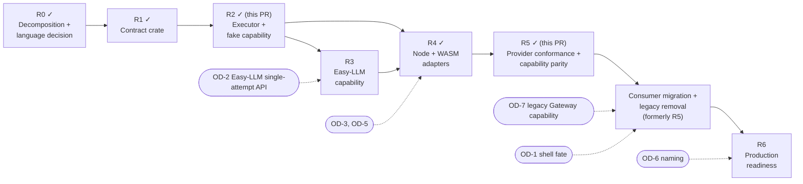

# Implementation roadmap

The rebuild uses the R0–R6 sequence from [RUST_PRIMITIVES.md](RUST_PRIMITIVES.md) §12. Rust is the implementation language of the new core (OD-9). The Zig implementation under `src/` remains the behavioral oracle until the consumer migration, and it is never a second supported inference core.

Every PR keeps the existing gates intact: `zig fmt --check src/`, `zig build test`, Full CI on the four native runners, the N-API and WASM SDK lanes, and the ship gate described in `AGENTS.md`. From R1 on, the **Rust core** workflow (`.github/workflows/rust-core.yml`) is an additional gate for any change under `rust/` or to `rust-toolchain.toml`.

## R0: Decomposition and language decision (done)

**Delivered by:** the merged decomposition PRs (`docs/rebuild/`: audits, inventories, capability ledger, behavior matrix, Vercel trace, risks, decisions), `RUST_PRIMITIVES.md`, and the language decision recorded in this PR (OD-9).

**Exit:** one normative design. Architecture, roadmap, README, decisions and risks agree that Rust is normative and Zig is the oracle.

## R1: Contract crate (done)

**Scope**
- `rust-toolchain.toml` (pinned 1.97.0) and `rust/fx-core/` (`Cargo.toml`, `Cargo.lock`, `src/{lib,contract,validate,wire,json_check,base64,redact}.rs`).
- Contract types, the single `Limits` table, deterministic request validation, event bound checks, and versioned strict JSON encoding for requests, events, outcomes and capability errors.
- Deterministic tests: `tests/contract_roundtrip.rs`, `tests/contract_validation.rs`, and `tests/contract_fixtures.rs` with 45 fixtures under `tests/fixtures/contract/`.
- Gates: `cargo fmt --check`, `cargo clippy --locked --all-targets -- -D warnings`, `cargo test --locked`, native and `wasm32-unknown-unknown` release builds, and `check-boundaries.sh` (dependency allowlist, forbidden crates, exact pins, forbidden source patterns). These run on Linux and macOS in `rust-core.yml`.

**Not in scope:** executor, capability trait, Easy-LLM, N-API/WASM ABI, product callers, Gateway deletion, npm changes.

**Exit:** the contract is executable, validated, versioned and bounded. Every R1 behavior maps to a named test (BEHAVIOR_MATRIX §8). Invalid and oversized requests are rejected before any capability could be invoked.

## R2: Executor and fake capability (this PR)

**Delivered**
- `capability.rs`: the non-blocking `Capability` trait (`start`, bounded `poll`, `cancel`, `close`) from RUST_PRIMITIVES §6, with `AttemptContext`, `PollBatch`, `StreamState`, `CancelStatus` and `Started`.
- `executor.rs`: `execute` and `execute_document`, the one-attempt state machine with the `Host` callbacks (`cancel_requested`, `on_event`, `idle`) and `ExecutionReport`.
- `normalize.rs`: invariants I1–I10 over typed events, `classify` (oracle `classifyProviderCompletion`) and `admit_proposals` (oracle `authoritativeToolAdmission`, structural only).
- `diagnostics.rs`: content-free `Diagnostics`, `RequestShape` and `TerminalCause`.
- `testing.rs`: the deterministic `FakeCapability` (scripted start, batches, pending, stall and failures; honest cancel status; recorded invocation counts).
- `Limits` gains `max_events_per_poll`, `max_events_per_attempt` and `max_polls_per_attempt`.
- Tests: `tests/executor.rs` (47 tests across validation and invocation, events and terminal state, delivery certainty, cancellation C1–C5, bounds and diagnostics, isolation) and `tests/executor_fixtures.rs` running 22 oracle-cited fixtures under `tests/fixtures/executor/`.
- `check-boundaries.sh` additionally forbids global mutable state (`static mut`, `thread_local!`, `std::sync`, lazy statics) so concurrent executions stay isolated (BM-11).

**Deferred from the original R2 scope** (recorded in BEHAVIOR_MATRIX §9.4):
- Live oracle replay through a Zig test harness against `consumeSseStream`. It needs Zig changes, and R2 keeps `src/` unchanged; parity is established from the cited oracle tests instead.
- Throughput micro-benchmark (moves to R6 with the other performance gates).
- Wire encoding of `ExecutionReport` (proposal checks, disposition, diagnostics), which moves to R4 with the adapters that need it.

**Dependencies:** R1. OD-8 (malformed-event policy) is already resolved.

**Exit:** deterministic native conformance with no network, credentials or provider dependency.

## R3: Single-attempt provider capability (done)

**Delivered here**
- `rust/fx-single-attempt`: a separate crate (its only dependency is `fx-core`, so `fx-core`'s allowlist does not grow) with the `ProviderPort` trait, the `SingleAttemptCapability` adapter that implements `fx_core::Capability` over it, the mapping rules, a scripted `FakePort`, 31 offline tests that run the real executor over it, its own `check-boundaries.sh`, and a CI job in `rust-core.yml`.
- [SINGLE_ATTEMPT.md](SINGLE_ATTEMPT.md): the audit of direct provider invocation versus the routed path, what FX needs from the provider layer, the mapping, and the gaps with the smallest change for each.

**Delivered in `rkendel1/llm`:** the provider-side operation (`generateOnce` / `streamOnce`, rkendel1/llm#13, merged). R4 added HTTP status, `Retry-After` and OpenAI-style stream finish reasons there (rkendel1/llm#14).

**Not delivered in R3:** the host that implements `ProviderPort` over it (R4).

**Original scope, still open**
- A lower-level **single-attempt** API in `rkendel1/llm` that exposes the events and terminal semantics FX needs without model fallback or duplicated routing policy. FX does not call the high-level `llm()` function.
- Collapse the three inference entry paths (agent loop, web-search worker, permission reviewer) onto the executor. Consumer policy stays with its owners.
- If the shell must keep working before Easy-LLM is ready, the legacy Gateway path becomes a consumer-owned capability outside the core, with a fixed deletion PR (OD-7).

**Dependencies:** R2, OD-2.

**Exit:** no compile-time provider choice and no provider implementation inside the FX core.

## R4: Host bridge for real providers (done)

**Delivered here** (details and limits in [HOST_BRIDGE.md](HOST_BRIDGE.md))
- `fx_core::Execution`: the executor as a resumable state machine (`step`, `cancel`); `execute` is a loop over it. `fx_core::encode_report`: the JSON encoding of an `ExecutionReport` (deferred from R2).
- `rust/fx-host`: the safe, portable `Session` (a message protocol over `fx-core` and `fx-single-attempt`) and the WebAssembly ABI, which imports nothing and holds the only raw-pointer code, compiled for `wasm32` only. Its own boundary gate.
- `host/node`: the Node host. One entry point (`createFxRuntime().execute`) runs an FX request through the Rust executor against an explicit Easy-LLM provider via `generateOnce` / `streamOnce`. Type check, lint, 71 offline tests (26 shared conformance fixtures run natively and on WebAssembly with identical responses, an end-to-end suite over mock providers, and a suite that drives the real OpenAI adapter against a local mock endpoint), a runnable example and an optional live smoke test.
- CI: `host-bridge.yml` (Rust host on Linux and macOS; Node host on Node 22 and 24, and 22 on macOS).
- Companion change in `rkendel1/llm` (#14): HTTP status, `Retry-After` and stream finish reasons, so a real stream completes and an error keeps the facts the provider sent.

**Deviation from the original R4 scope**
- Node is served by the WebAssembly module, not an N-API addon. The brief asked for no new binding technology without need, the WebAssembly module is required anyway, and one code path serves Node and any other WebAssembly host. N-API stays an option if a measured need appears (OD-3 remains open for that case).
- The ABI is a message protocol (`fx_begin` / `fx_command`), not the `fx_create` / `fx_push_event` / `fx_poll` sketch in RUST_PRIMITIVES §10 (OD-5 is satisfied: no WASI, no JSPI, no imports).
- ABI fuzzing, a performance measurement and a browser host are not done (see HOST_BRIDGE.md "Not production ready").

**Dependencies:** R2, R3.

**Exit:** equivalent outcomes for every applicable fixture on native and WebAssembly (met for the 26 host fixtures); a real Easy-LLM adapter returns a normalized FX outcome (met against a local mock; no live provider in CI).

## R5: Provider conformance and capability parity (this PR)

**Delivered here** (the answer, per provider, is [PROVIDER_CONFORMANCE.md](PROVIDER_CONFORMANCE.md); method and limits in [HOST_BRIDGE.md](HOST_BRIDGE.md) "Provider conformance")
- `host/node/conformance`: a mock server that speaks the wire format of all five Easy-LLM adapters (OpenAI, OpenRouter, Anthropic, Google, Ollama), and 34 cases that run the real, unmodified adapters through the real Rust executor (WebAssembly). 167 provider runs, deterministic and offline, plus universal invariants checked on every attempt.
- A versioned capability manifest (`conformance/manifest.json`): sixteen features per provider, each `supported`, `unsupported` or `unverified`. `npm run conformance` fails if a status is not backed by the results (for example `supported` without a passing case), if the suite is not deterministic, or if the generated document is stale.
- A correction found by the suite: a collected (non-streaming) response with no finish reason, including a body that parses but is not a response, was reported as a completion with finish `other`. It is now an interrupted attempt, the same rule as a stream (`host/node/src/translate.js`).
- The Easy-LLM dependency is the published `@easy-llm/llm@0.10.2`, pinned exactly (no git ref, no branch); the npm release contains the single-attempt API.
- CI: the conformance lane in `host-bridge.yml` on Node 22 and 24 (Linux) and 22 (macOS).

**Not delivered, by design**
- No change to `rkendel1/llm`. Gaps the suite finds there (Google never carries a stream finish reason; Anthropic and Ollama streams do not carry theirs; the OpenAI-style adapters keep reading after the provider's terminal marker; stream lines that fail to parse are skipped) are recorded as `unsupported` with the evidence, and need Easy-LLM changes. FX adds no workaround.
- No live provider was run. Every status is mock-backed.
- No retry, fallback or routing; no tool execution; no new provider abstraction beside `ProviderPort`.

**Exit:** every adapter has deterministic conformance results; the manifest matches them; no unverified stream is normalized into a success (met for all five; Google streaming completion stays `unsupported`).

## R6: Integrate Rust Chip with the authoritative FX (this PR)

**Delivered here** (decision and evidence: [CHIP_FX_RUNTIME.md](CHIP_FX_RUNTIME.md))
- Rust Chip (`rkendel1/chip-rs`) runs its inference through this repository's FX via the explicit adapter `chip-fx`; the duplicate toy FX core in chip-rs is removed.
- One shared WebAssembly export surface (`rust/wasm-abi`) used by both `rust/fx-host` and Chip's `chip-wasm-host`; `host/node` `createChipRuntime` drives Chip, which drives FX, which drives the real Easy-LLM adapters.
- Offline end to end tests, an offline multi-step example with one authorized tool interaction, and parity against a recording of the real Zig binary with four documented intentional differences (D1-D4).
- Machine-checked retirement gates (`docs/rebuild/tools/check_retirement.py`, `retirement.json`) and the `unified-runtime.yml` workflow.

**Not delivered, by design**
- `chip-legacy-http` is not removed: the native `chip` binary has no Easy-LLM host. Zig responsibilities (permission modes, provider tool loop, persistence, TUI, ACP, SDK) are not ported and stay blocked with recorded blockers.
- No live provider was run.

**Exit:** one authoritative FX used by Chip; boundary checks fail CI on violations; blockers for the remaining legacy code are explicit.

## Consumer migration and legacy removal (formerly R5)

This work keeps its content and dependencies; only its label changed when R5 was assigned to provider conformance. Other documents that say "R5" for consumer migration (RISKS, ARCHITECTURE, VERCEL_TRACE) mean this item.

**Scope**
- Migrate the Zig consumers (agent loop, `fx ask`, ACP, vision, web search, permission reviewer) to the Rust executor through the boundary chosen in R4. Then remove `stream_provider.Provider` and `ProviderAttemptOwner`.
- Move recovery policy to Chip, provider concerns to Easy-LLM, and process/sandbox concerns to Compute, per [CAPABILITIES.md](CAPABILITIES.md).
- Execute the removal ledger ([VERCEL_TRACE.md](VERCEL_TRACE.md) §4). Update the PGSO corpus with each E2E move or removal (R-14).
- Do this only after parity is demonstrated: E2E `gateway-stream-lifecycle`, `tui-gateway-stream-lifecycle`, `session-recovery`, `vision-route-fake-gateway`, `web-search-fake-gateway` and `tui-interrupt-recovery` pass unchanged against the new path, and `fx ask --json` against `tools/fake_gateway.py` produces byte-identical output.

**Dependencies:** R3, R4, R5 (provider conformance), OD-1, OD-7.

**Exit:** no duplicate seam, no unowned behavior, no unexplained deleted test.

## R6: Production readiness

**Scope**
- Full CI and Rust core CI on every supported runner, recorded at the exact commit.
- ABI/API compatibility notes and migration documentation.
- Benchmarks: startup, memory, event throughput, cancellation latency, binary and WASM size.
- Licenses and notices, including the Rust dependency licenses.
- Release workflow changes from the removal ledger (no Vercel Blob, CDN deploy hook or AI-Gateway changelog drafting).

**Dependencies:** consumer migration, OD-6.

**Exit:** all conformance, performance, security and release gates are green.

## Superseded numbering

The earlier plan numbered six Zig PRs ("PR 1" to "PR 6", with a Zig module at `src/fx/`). That numbering is superseded by R0–R6. The mapping is: PR 1 → R0 + R1, PR 2 → R2, PR 3 → R3, PR 4 → R4, PR 5 → R5, PR 6 → R6. The Zig `src/fx/` module will not be created.
